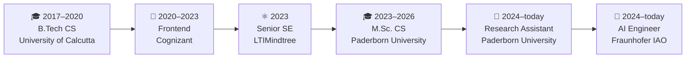
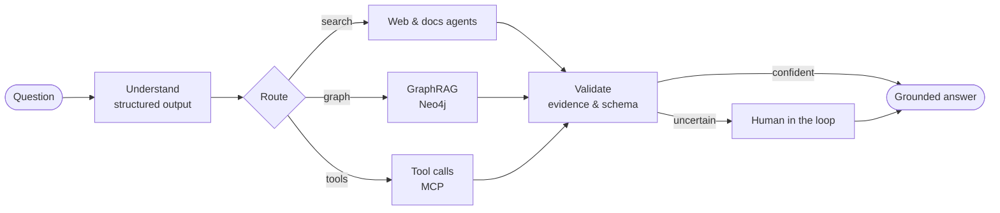

<p align="center">
  
</p>

<p align="center">
  
</p>

<p align="center">
  <a href="https://www.linkedin.com/in/soumitri-mukherjee"></a>
  <a href="mailto:mail.soumitri@gmail.com"></a>
  
  
</p>

---

### 🧭 From pixels to agents

I started as a **frontend engineer**: production React and TypeScript apps for Nike at
Cognizant, then a legacy telecom portal rebuilt in React and Redux at LTIMindtree. My
master's in Germany pulled me into **Python, search and knowledge graphs**, and from there
into **LLMs and agentic systems**, which I now build at Fraunhofer IAO.

Each stage added a layer instead of replacing one. Today I can take a feature all the way
from the **React component** through the **FastAPI service**, **graph and vector
retrieval** and the **LangGraph agent and its evaluation** to the **Docker and Kubernetes
deployment**. I'm comfortable wherever the problem happens to be in the stack.

```python
class Soumitri(Agent):
    role       = "AI Engineer @ Fraunhofer IAO · Research Assistant @ Paderborn University"
    education  = "M.Sc. Computer Science, Paderborn University"
    layers     = ["frontend", "backend", "data & graphs", "LLM agents", "infrastructure"]
    principles = {
        "LLM output": "validated before anyone sees it",
        "scores and severity": "computed in code, not guessed by the model",
        "uncertain cases": "routed to a human in the loop",
    }
    languages  = {"English": "C1", "German": "B1, improving"}
```

### 🛤️ The path so far



| When | Where | What I did | Stack I added |
|---|---|---|---|
| **2020 – 2023** | **Cognizant** · Software Engineer, Frontend | Production React apps for Nike: features, code reviews, API integration, testing and support. A high-volume inventory management UI with multi-step validation and SAP integration |  |
| **2023** | **LTIMindtree** · Senior Software Engineer | Migrated a legacy telecom customer portal to a component-based React/Redux architecture. About 80× faster rendering of a core flow and about 50% shorter load time |  |
| **2024 – today** | **Paderborn University** · Research Assistant, ML & Optimisation group | A university-wide knowledge graph of publications, real-time disinformation detection on Twitter and Bluesky, synthetic tweet datasets from multiple LLMs, and a DeepL glossary platform with CI/CD |  + LLMs, SPARQL/RDF, Hugging Face |
| **2024 – 2025** | **Paderborn University & OPTANO** · GenUI | An open-source RAG assistant for an optimisation platform's docs, plus an AI Excel-automation module |  + RAG |
| **2024 – today** | **Fraunhofer IAO** · AI Engineer | A supplier cybersecurity risk platform with multi-agent LangGraph workflows (about 60% less manual effort), and insider-threat signal extraction for AeroKI with human-in-the-loop review |  + LangGraph, MCP, Pydantic |
| **2026 – today** | **Personal project** · Kubernetes incident assistant | An agent that troubleshoots Kubernetes incidents from the official docs and historical GitHub issues, with conversation memory |  + LangGraph, GraphRAG, Neo4j |

### 🧰 Toolbox

| Layer | Tools |
|---|---|
| **Frontend** |  |
| **Backend** |    |
| **Data & graphs** |      |
| **AI / LLM** |         |
| **Infrastructure** |  |
| **AI & automation tools** |       |

### 🧠 How I build agents



### 📌 Featured work

| | Project | What it does |
|:-:|---|---|
| 🛠️ | **[troubleshooting-kubernetes-issues-agent](https://github.com/SoumitriM/troubleshooting-kubernetes-issues-agent)** | Investigates Kubernetes incidents, asks follow-up questions, and recommends fixes from the official docs and historical GitHub incidents. Built with LangGraph, GraphRAG on Neo4j, conversation memory, FastAPI and React |
| 🛡️ | **[mitre-attack-mapping](https://github.com/SoumitriM/mitre-attack-mapping)** | Turns CVEs into evidence-grounded attack chains mapped to MITRE ATT&CK, with a CLI and a FastAPI service backed by Neo4j |
| 🔭 | **[artificial-tweet-analysis-with-binoculars](https://github.com/SoumitriM/artificial-tweet-analysis-with-binoculars)** | Analysis of AI-generated tweets with the [Binoculars](https://arxiv.org/abs/2401.12070) zero-shot detector (original method by Hans et al.) |
| 📚 | **[glossary-app-frontend](https://github.com/SoumitriM/glossary-app-frontend)** · **[backend](https://github.com/SoumitriM/glossary-app-backend)** | A university-wide English–German terminology platform used with DeepL, with automated tests, CI/CD and production deployment |

### 🐍 Contribution graph, eaten

<p align="center">
  <picture>
    <source media="(prefers-color-scheme: dark)" srcset="https://raw.githubusercontent.com/SoumitriM/SoumitriM/output/github-snake-dark.svg"/>
    
  </picture>
</p>

<p align="center">
  
</p>
