<p align="center">
  
</p>

<p align="center">
  <a href="https://www.linkedin.com/in/soumitri-mukherjee"></a>
  <a href="mailto:mail.soumitri@gmail.com"></a>
  
  
</p>

---

### 🧭 From pixels to agents

I started as a **frontend engineer**: production React and TypeScript apps for Nike at
Cognizant, then a legacy telecom portal rebuilt in React and Redux at LTIMindtree. My
master's in Germany pulled me into **Python, search and knowledge graphs**, and from there
into **LLMs and agentic systems**, which I now build at Fraunhofer IAO.

Each stage added a layer instead of replacing one. Today I can take a feature all the way
from the **React component** through the **FastAPI service**, **graph and vector
retrieval** and the **LangGraph agent and its evaluation** to the **Docker and Kubernetes
deployment**. I'm comfortable wherever the problem happens to be in the stack.

```python
class Soumitri(Agent):
    role       = "AI Engineer @ Fraunhofer IAO · Research Assistant @ Paderborn University"
    education  = "M.Sc. Computer Science, Paderborn University"
    layers     = ["frontend", "backend", "data & graphs", "LLM agents", "infrastructure"]
    principles = {
        "LLM output": "validated before anyone sees it",
        "scores and severity": "computed in code, not guessed by the model",
        "uncertain cases": "routed to a human in the loop",
    }
    languages  = {"English": "C1", "German": "B1, improving"}
```

### 🛤️ My roadmap

<sub>Newest first. Every stage added a layer to the stack instead of replacing one.</sub>

<table>
  <tr>
    <td align="center" width="130"><br/><sub>📍 now</sub></td>
    <td align="center" width="270"></td>
    <td><b>Kubernetes Incident Resolution Assistant</b><br/><sub>Personal project</sub><br/><br/>Built an AI assistant that investigates Kubernetes incidents, asks follow-up questions and recommends fixes from the official documentation and historical GitHub incidents.<br/><sub><b>Worked with:</b> Python · LangGraph · GraphRAG · Neo4j · FastAPI · React · Docker · Kubernetes</sub></td>
  </tr>
  <tr>
    <td align="center" width="130"></td>
    <td align="center" width="270"></td>
    <td><b>AI Engineer (Research Assistant)</b><br/><sub>Fraunhofer IAO · Stuttgart / Remote</sub><br/><br/>Building a supplier cybersecurity risk platform with multi-agent LangGraph workflows, and a two-stage LLM system that extracts insider-threat risk signals for the government-funded AeroKI project, with human-in-the-loop review.<br/><sub><b>Worked with:</b> Python · LangGraph · FastAPI · Pydantic · MCP · multi-LLM (OpenRouter) · React · TypeScript · Kubernetes · Docker</sub></td>
  </tr>
  <tr>
    <td align="center" width="130"></td>
    <td align="center" width="270"></td>
    <td><b>Research Assistant</b><br/><sub>Machine Learning & Optimisation Group, Paderborn University</sub><br/><br/>Building a university-wide knowledge graph of academic publications and a real-time pipeline that detects disinformation campaigns on Twitter and Bluesky. Built and deployed a DeepL glossary platform, and the GenUI RAG assistant with OPTANO.<br/><sub><b>Worked with:</b> Python · LLMs (Gemini, Llama, OpenAI, DeepSeek, Qwen) · Elasticsearch · SPARQL / RDF · Hugging Face · scikit-learn · React · TypeScript · Node.js · Docker</sub></td>
  </tr>
  <tr>
    <td align="center" width="130"></td>
    <td align="center" width="270"></td>
    <td><b>M.Sc. Computer Science</b><br/><sub>Paderborn University</sub><br/><br/>Master's thesis on <i>Leveraging AI for Supplier Security Risk Evaluation</i>, an agentic system for automated supplier risk assessment. Master's project: an AI assistant for an optimisation platform.<br/><sub><b>Worked with:</b> Agentic AI · RAG · LLM evaluation</sub></td>
  </tr>
  <tr>
    <td align="center" width="130"></td>
    <td align="center" width="270"></td>
    <td><b>Senior Software Engineer</b><br/><sub>LTIMindtree · Kolkata, India</sub><br/><br/>Modernised a legacy telecommunications customer portal by migrating its core modules to a component-based React and Redux architecture, with reusable typed components and REST integrations.<br/><sub><b>Worked with:</b> React · Redux · TypeScript · JavaScript · REST APIs</sub></td>
  </tr>
  <tr>
    <td align="center" width="130"></td>
    <td align="center" width="270"></td>
    <td><b>Software Engineer – Frontend</b><br/><sub>Cognizant Technology Solutions · Kolkata, India</sub><br/><br/>Developed and maintained production React applications for Nike, from feature development and code reviews to testing and production support. Built an inventory management UI for large datasets with SAP integration.<br/><sub><b>Worked with:</b> React · TypeScript · JavaScript · Material UI</sub></td>
  </tr>
  <tr>
    <td align="center" width="130"><br/><sub>🚀 where it started</sub></td>
    <td align="center" width="270"></td>
    <td><b>B.Tech. Computer Science</b><br/><sub>University of Calcutta · Kolkata, India</sub><br/><br/>My foundations in computer science.</td>
  </tr>
</table>

### 🧰 Toolbox

| Layer | Tools |
|---|---|
| **Frontend** |  |
| **Backend** |    |
| **Data & graphs** |      |
| **AI / LLM** |         |
| **Infrastructure** |  |
| **AI & automation tools** |       |

### 🧠 How I build agents


### 📌 Featured work

| | Project | What it does |
|:-:|---|---|
| 🛠️ | **[troubleshooting-kubernetes-issues-agent](https://github.com/SoumitriM/troubleshooting-kubernetes-issues-agent)** | Investigates Kubernetes incidents, asks follow-up questions, and recommends fixes from the official docs and historical GitHub incidents. Built with LangGraph, GraphRAG on Neo4j, conversation memory, FastAPI and React |
| 🛡️ | **[mitre-attack-mapping](https://github.com/SoumitriM/mitre-attack-mapping)** | Turns CVEs into evidence-grounded attack chains mapped to MITRE ATT&CK, with a CLI and a FastAPI service backed by Neo4j |
| 🔭 | **[artificial-tweet-analysis-with-binoculars](https://github.com/SoumitriM/artificial-tweet-analysis-with-binoculars)** | Analysis of AI-generated tweets with the [Binoculars](https://arxiv.org/abs/2401.12070) zero-shot detector (original method by Hans et al.) |
| 📚 | **[glossary-app-frontend](https://github.com/SoumitriM/glossary-app-frontend)** · **[backend](https://github.com/SoumitriM/glossary-app-backend)** | A university-wide English–German terminology platform used with DeepL, with automated tests, CI/CD and production deployment |

### 🐍 Contribution graph, eaten

<p align="center">
  <picture>
    <source media="(prefers-color-scheme: dark)" srcset="https://raw.githubusercontent.com/SoumitriM/SoumitriM/output/github-snake-dark.svg"/>
    
  </picture>
</p>

<p align="center">
  
</p>
